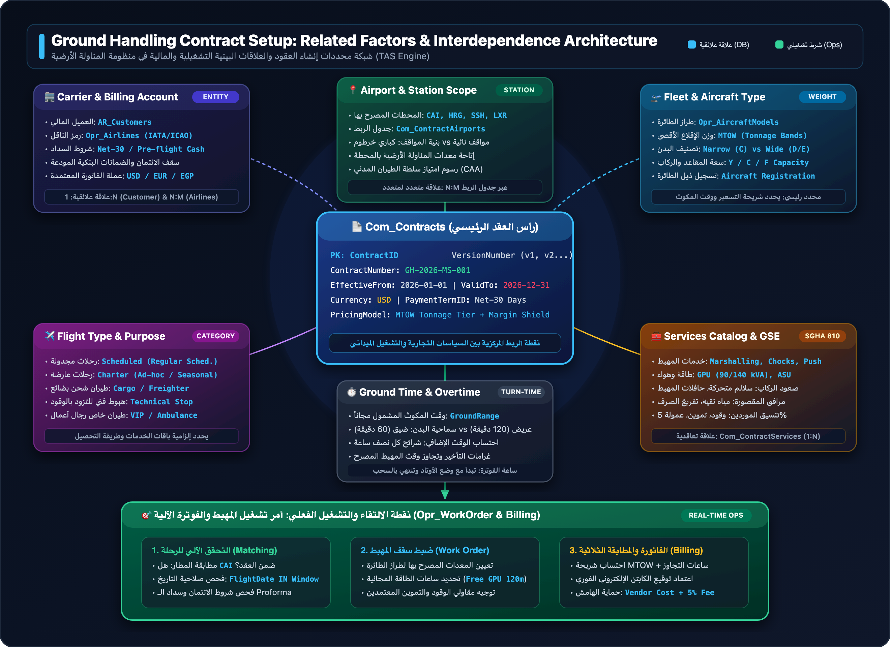
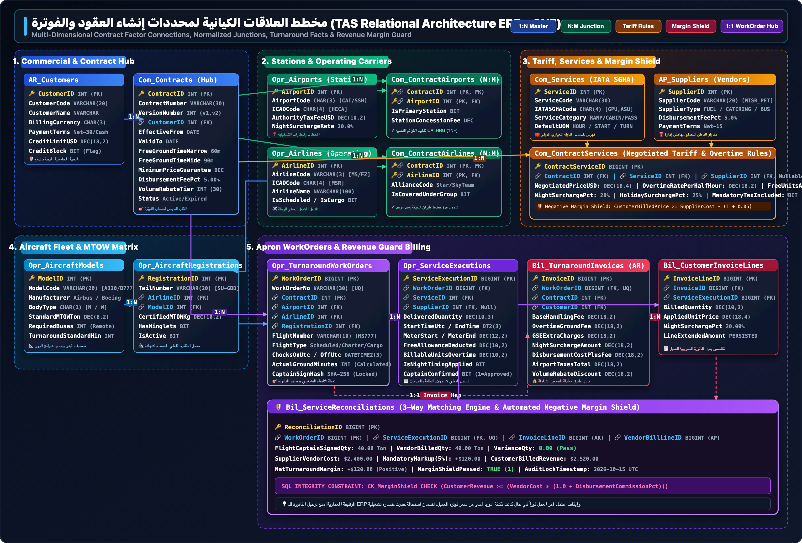

# دليل محددات إنشاء العقود وشبكة العلاقات البينية في منظومة المناولة الأرضية
## Ground Handling Contract Factors, Parameters & Relational Architecture Guide (TAS Engine)

---

## 📌 1. مقدمة عامة ورؤية معمارية (Executive Overview)

في صناعة المناولة الأرضية للطيران الدولي (**Aviation Ground Handling & Turnaround Services**)، لا يُعد العقد مجرد وثيقة قانونية أو نص أرشيفي؛ بل هو **محرك حسابي وتشغيلي متعدد الأبعاد (Multi-Dimensional Active Calculation Engine)**. 

عند تأسيس عقد جديد (**New Contract Master Setup**)، تتشابك مجموعة مترابطة من المحددات التشغيلية، والفيزيائية (كأوزان الطائرات)، والجغرافية (المحطات والمطارات)، والتجارية (شروط الائتمان وهوامش الربح). يُحدد هذا العقد بدقة:
1. **الغطاء التعاقدي:** من هي شركات الطيران المشمولة، وأي محطات مسموح لها بالهبوط فيها.
2. **حدود التشغيل في المهبط:** ما هي المعدات وساعات الطاقة (GPU) المسموحة مجاناً لكل طراز طائرة.
3. **محرك الفوترة الآلية:** كيفية احتساب التكلفة الفعلية استناداً إلى وزن الطائرة (MTOW)، والتوقيت (ليلي/نهاري)، والخدمات الإضافية، وحماية هوامش الربح مع مقاولي الباطن.

---

## 🗺️ 2. المخطط البصري العام: شبكة محددات العقد والعلاقات البينية

يوضح المخطط التالي الأبعاد الستة الرئيسية الحاكمة لإنشاء أي عقد أرضي، وكيف تلتقي جميعها في جدول العقد الرئيسي (`Com_Contracts`)، لتتحول في النهاية إلى **أمر تشغيل في المهبط (`Opr_WorkOrder`)** و**فاتورة معتمدة ومحمية من الهامش السالب**:

  
  
💡 يمكنك النقر على المخطط أعلاه لفتحه بصيغة الفيكتور فائقة الدقة (SVG).

---

## 🧩 3. الفهرس التفصيلي لمحددات العقد (Core Contract Factors)

عند النقر على زر **"إنشاء عقد جديد" (Create New Contract)** داخل نظام TAS، يتطلب النظام ضبط وتغذية 7 مجموعات محددات جوهرية:

  <!-- FACTOR 1: CARRIER & CUSTOMER -->
  

  

  

  🏢
  <h3 style="margin: 0; color: #c7d2fe; font-size: 18px; font-weight: 800;">1. محددات الناقل والعميل المالي (Carrier &amp; Billing Entity Factors)</h3>
  

  COMMERCIAL &amp; CREDIT
  

  

  
يُميز النظام بدقة بين <strong style="color: #ffffff;">الجهة التي تدفع الفاتورة (Customer / Debtor)</strong> وبين <strong style="color: #ffffff;">شركة الطيران المشغلة للرحلة (Operating Carrier)</strong>:

  <ul style="margin: 10px 24px; color: #f8fafc;">
  <li><strong style="color: #38bdf8;">العميل المالي المحاسبي (<code>CustomerID / AR_Customers</code>):</strong> قد يكون شركة الطيران نفسها، أو وسيط رحلات عارضة (Charter Broker)، أو منظم رحلات سياحية (Tour Operator مثل TUI)، أو وكيل خدمات ملاحة وإشراف (Trip Support Agency مثل Jetex أو Hadid).</li>
  <li><strong style="color: #38bdf8;">رمز الناقل الجوي (<code>AirlineID / Opr_Airlines</code>):</strong> الرموز المعتمدة لمنظمة الطيران المدني الدولي والاتحاد الدولي للنقل الجوي (IATA/ICAO Codes مثل <code>MS / MSR</code> لمصر للطيران، <code>FZ / FDB</code> لفلاي دبي، <code>TK / THY</code> للتركية). يمكن للعقد الواحد تغطية عدة خطوط طيران شقيقة تتبع نفس المجموعة القابضة.</li>
  <li><strong style="color: #38bdf8;">شروط الائتمان والسداد (<code>PaymentTermsID</code>):</strong>
  Net-14 / Net-30 Days للرحلات المجدولة الموثوقة، أو
  Pre-flight Cash / Proforma Wire Transfer بنسبة 100% للرحلات العارضة غير المنتظمة.</li>
  <li><strong style="color: #38bdf8;">عملة العقد والفوترة (<code>BillingCurrency</code>):</strong> العملة التعاقدية الملزمة (USD، EUR، أو EGP محلياً)، مع قاعدة ربط سعر الصرف الرسمي للبنك المركزي بتاريخ تنفيذ الرحلة.</li>
  <li><strong style="color: #38bdf8;">سقف الائتمان والضمان البنكي (Credit Limit &amp; Bank Guarantee):</strong> الحد المالي الأقصى المسموح به للمديونية قبل إيقاف إصدار أوامر التشغيل تلقائياً.</li>
  </ul>
  

  

  <!-- FACTOR 2: AIRPORT & STATIONS -->
  

  

  

  📍
  <h3 style="margin: 0; color: #6ee7b7; font-size: 18px; font-weight: 800;">2. محددات النطاق الجغرافي والمحطات (Airport &amp; Station Scope Factors)</h3>
  

  STATIONS &amp; APPRON
  

  

  
يحدد العقد المحطات الجوية المرخص بتقديم خدمات المناولة فيها:

  <ul style="margin: 10px 24px; color: #f8fafc;">
  <li><strong style="color: #34d399;">المطارات المعتمدة (<code>AirportID / Opr_Airports</code>):</strong> كود المطار الدولي (مثل: <code>CAI</code> مطار القاهرة، <code>HRG</code> الغردقة، <code>SSH</code> شرم الشيخ، <code>LXR</code> الأقصر، <code>HBE</code> برج العرب).</li>
  <li><strong style="color: #34d399;">نوع الاتفاقية الجغرافية:</strong> إما اتفاقية محطة واحدة (Single-Station Handling Agreement) أو اتفاقية شبكة مطارات موحدة (Multi-Station National Network Agreement).</li>
  <li><strong style="color: #34d399;">طبيعة مواقف الطائرات بالمحطة (Stand Infrastructure):</strong>
  <ul style="margin: 6px 20px;">
  <li><strong style="color: #ffffff;">مواقف متصلة بالمبنى (Contact Stands / Jet Bridges):</strong> تقتضي احتساب رسوم استهلاك خرطوم الركاب، وتلغي الحاجة لحافلات المهبط.</li>
  <li><strong style="color: #ffffff;">مواقف نائية (Remote Apron Stands):</strong> تقتضي إلزامياً توفير سلالم متحركة (Mobile Passenger Stairs) وحافلات نقل ركاب المهبط (Cobus).</li>
  </ul>
  </li>
  <li><strong style="color: #34d399;">رسوم وامتيازات سلطة الطيران المدني (CAA Concession &amp; Royalties):</strong> الرسوم السيادية ونسب الإتاوة التي تختلف من مطار لآخر (مثال: رسوم مطار القاهرة الدولي تختلف عن رسوم مطارات الجذب السياحي الإقليمية).</li>
  </ul>
  

  

  <!-- FACTOR 3: FLEET & AIRCRAFT TYPE -->
  

  

  

  🛫
  <h3 style="margin: 0; color: #7dd3fc; font-size: 18px; font-weight: 800;">3. محددات الأسطول وطراز الطائرات (Aircraft Fleet &amp; Weight Factors)</h3>
  

  MTOW &amp; BODY CLASS
  

  

  
يُمثل وزن الطائرة وهيكلها الأساس الفيزيائي الأول لتسعير المناولة حول العالم وفق معايير IATA AHM:

  <ul style="margin: 10px 24px; color: #f8fafc;">
  <li><strong style="color: #38bdf8;">طراز الطائرة (<code>ModelCode / Opr_AircraftModels</code>):</strong> كود الطراز العالمي (مثل: A320, A321, B737-800, B777-300ER, A330-300, B787-9).</li>
  <li><strong style="color: #38bdf8;">وزن الإقلاع الأقصى (MTOW - Maximum Take-Off Weight):</strong> المقياس القياسي لتحديد شريحة السعر الأساسي للمناولة (Handling Tonnage Bracket). تقسم الشرائح عادة إلى:
  [0-25t], [26-50t], [51-80t], [81-120t], [121-160t], [&gt;160t].</li>
  <li><strong style="color: #38bdf8;">تصنيف البدن (<code>BodyType</code>):</strong>
  <ul style="margin: 6px 20px;">
  <li><strong style="color: #ffffff;">بدن ضيق (Narrow-body / Code C):</strong> ممر واحد (مثل A320 / B737) - يحتاج وحدة طاقة أرضية (GPU 90 kVA)، وسلم ركاب واحد أو اثنين، ومعدل دوران قياسي 45 إلى 60 دقيقة.</li>
  <li><strong style="color: #ffffff;">بدن عريض (Wide-body / Code D/E/F):</strong> ممران (مثل B777 / A350) - يحتاج وحدة طاقة أرضية ثقيلة (GPU 140+ kVA)، رافعة منصات شحن سفلية (Main Deck Loader)، ومعدل دوران قياسي 90 إلى 120 دقيقة.</li>
  </ul>
  </li>
  <li><strong style="color: #38bdf8;">سعة المقاعد والركاب (Seat Capacity - Y/C/F):</strong> الحد الأقصى للمقاعد في الدرجة السياحية ورجال الأعمال والأولى (يستخدم عند احتساب رسوم الركاب Per-Passenger Head Charge).</li>
  <li><strong style="color: #38bdf8;">تسجيلات ذيل الطائرة (<code>Tail Number / Opr_AircraftRegistrations</code>):</strong> الحروف المعرفة للطائرة الفعلية المسجلة لدى الناقل (مثل: <code>SU-GCT</code> لمصر للطيران) لضمان الربط المباشر مع حركة الرادار وسجلات برج المراقبة.</li>
  </ul>
  

  

  <!-- FACTOR 4: FLIGHT OPERATION TYPE -->
  

  

  

  🔄
  <h3 style="margin: 0; color: #f0abfc; font-size: 18px; font-weight: 800;">4. محددات تصنيف الرحلة والغرض التشغيلي (Flight Mission &amp; Type Factors)</h3>
  

  FLIGHT CATEGORY
  

  

  
تختلف باقة الخدمات المطلوبة وشروط السداد وفقاً للغرض من تسيير الرحلة:

  <ul style="margin: 10px 24px; color: #f8fafc;">
  <li><strong style="color: #e879f9;">رحلات تجارية مجدولة (Scheduled Flights):</strong> رحلات يومية أو أسبوعية منتظمة بجدول معلن. يطبق عليها خصومات الحجم، وشروط الائتمان القياسية (Net-30)، وباقات المناولة الشاملة الكاملة.</li>
  <li><strong style="color: #e879f9;">رحلات عارضة / سياحية (Charter Flights):</strong> رحلات موسمية أو عارضة غير منتظمة. تتطلب سداد الفاتورة المبدئية (Proforma) بنسبة 100% قبل صدور تصريح الهبوط وفتح أمر العمل.</li>
  <li><strong style="color: #e879f9;">رحلات شحن بضائع (Cargo / Freighter Flights):</strong> طائرات شحن بدون ركاب. تستبعد خدمات الركاب والسلالم والمقصورة، وتلزم بإضافة رافعات المنصات (Main Deck Loaders) وعربات حاويات الشحن (ULD Dollies) واحتساب السعر بالطن المشحون.</li>
  <li><strong style="color: #e879f9;">هبوط فني للتزود بالوقود (Technical Stop / Ferry Flight):</strong> هبوط سريع لا يشمل ركاباً أو تفريغ حقائب. يقتصر على الإرشاد، وتأمين الوقود، والأوتاد، بزمن مكوث قصير وسعر مخفض ومحدد سلفاً.</li>
  <li><strong style="color: #e879f9;">طيران خاص ورجال أعمال (VIP / Business Aviation):</strong> متطلبات خدمة استثنائية تشمل صالات كبار الزوار، النقل بسيارات الليموزين بالمهبط، وحراسة خاصة.</li>
  </ul>
  

  

  <!-- FACTOR 5: SERVICES CATALOG & GSE -->
  

  

  

  🧰
  <h3 style="margin: 0; color: #fcd34d; font-size: 18px; font-weight: 800;">5. محددات فهرس الخدمات ومعدات المهبط (Services Catalog &amp; GSE Scope)</h3>
  

  IATA SGHA AHM 810
  

  

  
هيكلة بنود الاتفاقية وفق الفصول الدولية للاتحاد الدولي للنقل الجوي (IATA Standard Ground Handling Agreement):

  <ul style="margin: 10px 24px; color: #f8fafc;">
  <li><strong style="color: #fbbf24;">خدمات ساحة الطيران (Ramp Operations - Section 3):</strong> وضع وسحب الأوتاد (Chocks On/Off)، الإرشاد (Marshalling)، القاطرة والدفع للخلف (Pushback Tractor)، تحميل وتفريغ الحقائب.</li>
  <li><strong style="color: #fbbf24;">معدات الدعم الأرضي ووحدات الطاقة (GSE Units):</strong>
  GPU (Ground Power Unit) بنظام النصف ساعة أو الساعة،
  ASU (Air Start Unit) لبدء تشغيل المحركات،
  ACU (Air Conditioning Unit) لتبريد المقصورة.</li>
  <li><strong style="color: #fbbf24;">مرافق مقصورة الطائرة (Cabin Services):</strong> تزويد مياه الشرب العذبة النقية (Potable Water)، تفريغ ومعالجة الصرف الصحي (Lavatory Waste)، والنظافة السريعة (Transit Cleaning).</li>
  <li><strong style="color: #fbbf24;">خدمات الركاب (Passenger Services - Section 2):</strong> مكاتب وزن الأمتعة وقبول الركاب (Check-in Desks)، بوابات الصعود، مكاتب الحقائب الضائعة (Lost &amp; Found / WorldTracer).</li>
  <li><strong style="color: #fbbf24;">خدمات مقاولي الباطن والوقود (Third-Party / Disbursed Services):</strong> تنسيق شاحنات الوقود وسيارات الإطفاء المرافقة، التموين (Catering)، وتخضع لنسبة عمولة إدارة (Disbursement Handling Fee 5% إلى 10%).</li>
  </ul>
  

  

  <!-- FACTOR 6: TIME TOLERANCES & OVERTIME -->
  

  

  

  ⏱️
  <h3 style="margin: 0; color: #f1f5f9; font-size: 18px; font-weight: 800;">6. محددات زمن المكوث والسماحية (Turnaround Ground Time &amp; Tolerances)</h3>
  

  TIME WINDOWS
  

  

  
الزمن هو المحدد المالي الحاسم؛ فبقاؤ الطائرة على أرض المهبط يُكلف موارد بشرية ومعدات حيوية:

  <ul style="margin: 10px 24px; color: #f8fafc;">
  <li><strong style="color: #ffffff;">وقت المكوث القياسي المشمول مجاناً (<code>GroundRange / TimeInclude</code>):</strong>
  زمن دوران الطائرة المشمول ضمن السعر الأساسي (مثال: أول ساعتين مجاناً للطائرات ضيقة البدن، و3 ساعات للطائرات عريضة البدن).</li>
  <li><strong style="color: #ffffff;">شرائح احتساب الوقت الإضافي (Overtime Parking Gradients):</strong>
  في حال تأخر إقلاع الطائرة عن وقت السماح، يبدأ النظام في احتساب غرامات إشغال المهبط تلقائياً مجزأة لكل نصف ساعة إضافية.</li>
  <li><strong style="color: #ffffff;">ساعات الطاقة المشمولة مجاناً (Included GPU Hours):</strong>
  تحديد عدد ساعات عمل وحدة الكهرباء المشمولة مع الباقة (مثلاً: أول ساعة مجاناً؛ وما زاد عنها يُفوتر تلقائياً بسعر الساعة المقررة في العقد).</li>
  </ul>
  

  

  <!-- FACTOR 7: PRICING LOGIC, SURCHARGES & VOLUME -->
  

  

  

  💰
  <h3 style="margin: 0; color: #fda4af; font-size: 18px; font-weight: 800;">7. محددات التسعير والبدلات وحوافز الحجم (Pricing Mechanics &amp; Margin Rules)</h3>
  

  MARGIN &amp; REBATE
  

  

  
القواعد المالية الصارمة التي تضمن ربحية المناول وتمنع التسرب:

  <ul style="margin: 10px 24px; color: #f8fafc;">
  <li><strong style="color: #fb7185;">ضمان الحد الأدنى للإيراد (<code>MinimumPrice Guarantee</code>):</strong> سقف أدنى مالي لا يمكن فوترة الرحلة بأقل منه تحت أي ظرف (حتى لو كانت الطائرة فارغة أو بحمولة منخفضة) لتغطية تكاليف الطاقم والمعدات.</li>
  <li><strong style="color: #fb7185;">البدلات الإضافية للتشغيل الاستثنائي (<code>SureCharge</code>):</strong>
  نسب مئوية إضافية تضاف على السعر الأساسي للرحلة:
  بدل عمل ليلي (Night Surcharge +20% بين 22:00 و 06:00)،
  بدل عطلات وأعياد رسمية (+25%)،
  وبدل طلب خدمة طارئة في أقل من 24 ساعة (+30%).</li>
  <li><strong style="color: #fb7185;">حائط صد الهامش السالب مع الموردين (Margin Shield):</strong>
  قاعدة برمجية ملزمة تمنع فوترة أي خدمة منفذة عبر مقاول خارجي (وقود/تموين) بسعر يقل عن فاتورة المقاول الفعلية، وتضيف آلياً عمولة المناول (مثلاً: <code>تكلفة الوقود + 5% Disbursement Fee</code>).</li>
  <li><strong style="color: #fb7185;">شرائح خصم الحجم التراكمي (Volume Rebates):</strong>
  مكافأة الناقل عند تجاوزه عتبة عدد رحلات شهرياً (مثال: &gt; 25 رحلة شهرياً = خصم 5%؛ &gt; 50 رحلة شهرياً = خصم 10% يُمنح في نهاية الشهر كإشعار دائن Credit Note).</li>
  </ul>
  

  

---

## 🔗 4. مصفوفة العلاقات والتشابك البيني بين المحددات (Interdependence Matrix)

الجدول التالي يشرح **العلاقة الدقيقة (The Exact Relationship)** بين كل محددين، وكيف تؤثر التغييرات في محدد معين على باقي محددات النظام:

  

  📊 مصفوفة التأثير المتبادل والقواعد التشغيلية والمالية (Cross-Factor Interdependence Matrix)
  تكامل فيزيائي وتشغيلي ومالي
  

  

  <table class="matrix-table-dark" style="width: 100%; border-collapse: collapse; text-align: right; font-size: 13px;">
  <thead>
  <tr style="border-bottom: 2px solid #334155; background: #1e293b; color: #38bdf8;">
  <th style="padding: 12px 14px; font-weight: 800; color: #ffffff;">المحدد الأول (Factor A)</th>
  <th style="padding: 12px 14px; font-weight: 800; color: #38bdf8;">المحدد الثاني (Factor B)</th>
  <th style="padding: 12px 14px; font-weight: 800; color: #ffffff;">نوع العلاقة والترابط</th>
  <th style="padding: 12px 14px; font-weight: 800; color: #ffffff;">الأثر التشغيلي والمالي (Operational &amp; Financial Impact)</th>
  <th style="padding: 12px 14px; font-weight: 800; color: #ffffff;">القاعدة الحاكمة في النظام (TAS Business Rule)</th>
  </tr>
  </thead>
  <tbody>
  <!-- Row 1 -->
  <tr style="border-bottom: 1px solid #334155; background: #0f172a;">
  <td style="padding: 12px 14px; font-weight: 800; color: #ffffff;">طراز الطائرة (MTOW)</td>
  <td style="padding: 12px 14px; color: #38bdf8; font-weight: 800;">السعر الأساسي للمناولة (Base Rate)</td>
  <td style="padding: 12px 14px;">تناسب طردي حسب الوزن</td>
  <td style="padding: 12px 14px; color: #ffffff; font-weight: 600; line-height: 1.6;">كلما زاد وزن الطائرة (طن)، زادت شريحة المناولة ومقدار استهلاك معدات السحب والأوتاد.</td>
  <td dir="ltr" style="padding: 12px 14px; text-align: left;"><code style="background: #020617; color: #38bdf8; border: 1px solid #1e40af; padding: 5px 10px; border-radius: 4px; font-family: monospace; font-size: 12px; font-weight: 700; display: inline-block;">BaseRate = MTOW_Band_Rate(Model.MTOW)</code></td>
  </tr>
  <!-- Row 2 -->
  <tr style="border-bottom: 1px solid #334155; background: #17223b;">
  <td style="padding: 12px 14px; font-weight: 800; color: #ffffff;">طراز الطائرة (Body Type)</td>
  <td style="padding: 12px 14px; color: #38bdf8; font-weight: 800;">سماحية زمن المكوث (Ground Tolerance)</td>
  <td style="padding: 12px 14px;">محدد فيزيائي للبنية</td>
  <td style="padding: 12px 14px; color: #ffffff; font-weight: 600; line-height: 1.6;">البدن الضيق يمنح 60 دقيقة مجاناً، بينما العريض يمنح 90-120 دقيقة لكثافة الركاب وسعة العفش.</td>
  <td dir="ltr" style="padding: 12px 14px; text-align: left;"><code style="background: #020617; color: #38bdf8; border: 1px solid #1e40af; padding: 5px 10px; border-radius: 4px; font-family: monospace; font-size: 12px; font-weight: 700; display: inline-block;">FreeTime = IF(BodyType='W', 120m, 60m)</code></td>
  </tr>
  <!-- Row 3 -->
  <tr style="border-bottom: 1px solid #334155; background: #0f172a;">
  <td style="padding: 12px 14px; font-weight: 800; color: #ffffff;">طراز الطائرة (Body Type)</td>
  <td style="padding: 12px 14px; color: #38bdf8; font-weight: 800;">قدرة ونوع المعدات الأرضية (GSE Specification)</td>
  <td style="padding: 12px 14px;">اشتراط هندسي إلزامي</td>
  <td style="padding: 12px 14px; color: #ffffff; font-weight: 600; line-height: 1.6;">البدن العريض يلزم بتعيين GPU 140 kVA بدلاً من 90 kVA، وقاطرة سحب ثقيلة (Heavy Pushback).</td>
  <td dir="ltr" style="padding: 12px 14px; text-align: left;"><code style="background: #020617; color: #38bdf8; border: 1px solid #1e40af; padding: 5px 10px; border-radius: 4px; font-family: monospace; font-size: 12px; font-weight: 700; display: inline-block;">ValidateGSE(Model.BodyType, AssignedGSE)</code></td>
  </tr>
  <!-- Row 4 -->
  <tr style="border-bottom: 1px solid #334155; background: #17223b;">
  <td style="padding: 12px 14px; font-weight: 800; color: #ffffff;">المطار (Airport / Station)</td>
  <td style="padding: 12px 14px; color: #38bdf8; font-weight: 800;">طبيعة الخدمات الإلزامية (Mandatory Services)</td>
  <td style="padding: 12px 14px;">محدد بنية تحتية للموقف</td>
  <td style="padding: 12px 14px; color: #ffffff; font-weight: 600; line-height: 1.6;">المواقف النائية بمطارات HRG/SSH تلزم بتشغيل حافلات وسلالم، بينما مواقف الكباري تلغيها.</td>
  <td dir="ltr" style="padding: 12px 14px; text-align: left;"><code style="background: #020617; color: #38bdf8; border: 1px solid #1e40af; padding: 5px 10px; border-radius: 4px; font-family: monospace; font-size: 12px; font-weight: 700; display: inline-block;">Mutex(JetBridge, PassengerStairs + Bus)</code></td>
  </tr>
  <!-- Row 5 -->
  <tr style="border-bottom: 1px solid #334155; background: #0f172a;">
  <td style="padding: 12px 14px; font-weight: 800; color: #ffffff;">تصنيف الرحلة (Flight Type)</td>
  <td style="padding: 12px 14px; color: #38bdf8; font-weight: 800;">شروط السداد (Payment Terms)</td>
  <td style="padding: 12px 14px;">حوكمة ومخاطر ائتمانية</td>
  <td style="padding: 12px 14px; color: #ffffff; font-weight: 600; line-height: 1.6;">الرحلات العارضة (Charter) تلزم بسداد 100% مسبقاً، بينما المجدولة (Scheduled) تمنح Net-30.</td>
  <td dir="ltr" style="padding: 12px 14px; text-align: left;"><code style="background: #020617; color: #38bdf8; border: 1px solid #1e40af; padding: 5px 10px; border-radius: 4px; font-family: monospace; font-size: 12px; font-weight: 700; display: inline-block;">IF(FlightType='Charter') Enforce_Proforma()</code></td>
  </tr>
  <!-- Row 6 -->
  <tr style="border-bottom: 1px solid #334155; background: #17223b;">
  <td style="padding: 12px 14px; font-weight: 800; color: #ffffff;">تصنيف الرحلة (Technical Stop)</td>
  <td style="padding: 12px 14px; color: #38bdf8; font-weight: 800;">باقة الخدمات (Service Scope)</td>
  <td style="padding: 12px 14px;">استبعاد خدمات الركاب</td>
  <td style="padding: 12px 14px; color: #ffffff; font-weight: 600; line-height: 1.6;">الهبوط الفني يستبعد تلقائياً صعود الركاب، والتنظيف، والحقائب، ويقتصر على الوقود والأوتاد.</td>
  <td dir="ltr" style="padding: 12px 14px; text-align: left;"><code style="background: #020617; color: #38bdf8; border: 1px solid #1e40af; padding: 5px 10px; border-radius: 4px; font-family: monospace; font-size: 12px; font-weight: 700; display: inline-block;">Suppress(PassengerCheckIn, BaggageLoading)</code></td>
  </tr>
  <!-- Row 7 -->
  <tr style="border-bottom: 1px solid #334155; background: #0f172a;">
  <td style="padding: 12px 14px; font-weight: 800; color: #ffffff;">زمن المهبط الفعلي (Actual Ramp Time)</td>
  <td style="padding: 12px 14px; color: #38bdf8; font-weight: 800;">غرامات الوقت الإضافي (Overtime Billing)</td>
  <td style="padding: 12px 14px;">تجاوز حدود العقد</td>
  <td style="padding: 12px 14px; color: #ffffff; font-weight: 600; line-height: 1.6;">إذا تجاوز مكوث الطائرة من لحظة الأوتاد وقت السماح، تُحسب تلقائياً شرائح انتظار إضافية.</td>
  <td dir="ltr" style="padding: 12px 14px; text-align: left;"><code style="background: #020617; color: #38bdf8; border: 1px solid #1e40af; padding: 5px 10px; border-radius: 4px; font-family: monospace; font-size: 12px; font-weight: 700; display: inline-block;">OvertimeUnits = CEIL((RampTime - FreeTime) / 30m)</code></td>
  </tr>
  <!-- Row 8 -->
  <tr style="border-bottom: 1px solid #334155; background: #17223b;">
  <td style="padding: 12px 14px; font-weight: 800; color: #ffffff;">فاتورة المورد (Supplier Cost)</td>
  <td style="padding: 12px 14px; color: #38bdf8; font-weight: 800;">سعر فوترة العميل (Customer Disbursed Price)</td>
  <td style="padding: 12px 14px;">حماية الهامش الربحي</td>
  <td style="padding: 12px 14px; color: #ffffff; font-weight: 600; line-height: 1.6;">يُمنع فوترة خدمات الوقود والتموين بخسارة؛ يضاف هامش عمولة إدارة إلزامي فوق تكلفة المورد.</td>
  <td dir="ltr" style="padding: 12px 14px; text-align: left;"><code style="background: #020617; color: #38bdf8; border: 1px solid #1e40af; padding: 5px 10px; border-radius: 4px; font-family: monospace; font-size: 12px; font-weight: 700; display: inline-block;">CustomerBill = SupplierCost * (1 + MarkupPct)</code></td>
  </tr>
  <!-- Row 9 -->
  <tr style="background: #0f172a;">
  <td style="padding: 12px 14px; font-weight: 800; color: #ffffff;">حجم الرحلات الشهري (Monthly Volume)</td>
  <td style="padding: 12px 14px; color: #38bdf8; font-weight: 800;">خصم الحجم التجاري (Volume Rebate)</td>
  <td style="padding: 12px 14px;">حافز ولاء تجاري</td>
  <td style="padding: 12px 14px; color: #ffffff; font-weight: 600; line-height: 1.6;">وصول الناقل لأكثر من 30 رحلة شهرياً يُفعل خصم 5% على الفواتير التالية كإشعار دائن.</td>
  <td dir="ltr" style="padding: 12px 14px; text-align: left;"><code style="background: #020617; color: #38bdf8; border: 1px solid #1e40af; padding: 5px 10px; border-radius: 4px; font-family: monospace; font-size: 12px; font-weight: 700; display: inline-block;">IF(FlightCount &gt;= Tier) Apply_Rebate()</code></td>
  </tr>
  </tbody>
  </table>
  

---

## 🧮 5. مكعب التسعير متعدد الأبعاد والمعادلة الحسابية (Multi-Dimensional Pricing Cube)

عند تشغيل رحلة فعلية على أرض المهبط، يقوم **محرك الفوترة (TAS Pricing Engine)** بجمع وتطبيق جميع هذه المحددات عبر دالة رياضية موحدة:

  

    
tas_pricing_engine_formula.calc

    
المعادلة الحسابية الشاملة لاحتساب فاتورة الرحلة (TAS Engine)

  

  <pre dir="ltr" style="direction: ltr !important; text-align: left !important; unicode-bidi: isolate !important; margin: 0; padding: 22px; font-family: monospace; font-size: 13.5px; line-height: 1.85; background: #070d1e; overflow-x: auto; color: #f8fafc;">// TAS Unified Flight Invoice Pricing Formula (Left-to-Right Execution)
<strong style="color: #38bdf8;">TotalFlightInvoice</strong> = 
    <strong style="color: #fbbf24;">MAX</strong>(
        MinimumPriceGuarantee,
        (
            BaseHandlingFee(AirportID, Model.MTOW, FlightType)
            + OvertimeGroundFee(ActualGroundMinutes, GroundRangeLimit, OvertimeRatePerHalfHour)
            + ExtraGSECharges(ExtraGPUHours, ASUStarts, ACUHours)
            + AdHocCabinServices(WaterFlushes, ToiletFlushes, ExtraClean)
        ) * ( 1 + NightOrHolidaySurchargePct )
    )
    + SubcontractorDisbursements[ ActualFuelCost + CateringCost ] * ( 1 + DisbursementFeePct 5% )
    + MandatoryAirportAuthorityTaxes(AirportID)
    - VolumeTierDiscount(MonthlyAccumulatedFlights)
</pre>

  
📊 التحليل التفصيلي لمكونات المعادلة الخمسة وآلية عمل المحرك:

  <table class="matrix-table-dark" style="width: 100%; border-collapse: collapse; text-align: right; font-size: 12.5px;">
    <thead>
      <tr style="border-bottom: 2px solid #334155; background: #1e293b; color: #38bdf8;">
        <th style="padding: 10px 12px; font-weight: 800; text-align: left; color: #ffffff;">المكون في المعادلة (Formula Component)</th>
        <th style="padding: 10px 12px; font-weight: 800; color: #38bdf8;">البيان الوظيفي</th>
        <th style="padding: 10px 12px; font-weight: 800; color: #ffffff;">طريقة التطبيق والأثر الرقابي</th>
      </tr>
    </thead>
    <tbody>
      <tr style="border-bottom: 1px solid #334155; background: #0f172a;">
        <td dir="ltr" style="padding: 11px 12px; color: #fde047; font-family: monospace; font-weight: 800; text-align: left; unicode-bidi: isolate;"><code style="background: #020617; color: #fde047; padding: 4px 8px; border-radius: 4px; border: 1px solid #78350f;">MAX(MinimumPriceGuarantee, ...)</code></td>
        <td style="padding: 11px 12px; font-weight: 800; color: #ffffff;">حماية الحد الأدنى للسعر</td>
        <td style="padding: 11px 12px; color: #ffffff; font-weight: 500; line-height: 1.6;">مقارنة إجمالي الخدمات الأساسية بالحد الأدنى المضمون وتطبيق الأعلى لضمان تغطية تكلفة النزول.</td>
      </tr>
      <tr style="border-bottom: 1px solid #334155; background: #17223b;">
        <td dir="ltr" style="padding: 11px 12px; color: #c084fc; font-family: monospace; font-weight: 800; text-align: left; unicode-bidi: isolate;"><code style="background: #020617; color: #c084fc; padding: 4px 8px; border-radius: 4px; border: 1px solid #581c87;">(Base + Overtime + GSE + Cabin) * (1 + NightSurcharge)</code></td>
        <td style="padding: 11px 12px; font-weight: 800; color: #ffffff;">باقة المهبط وبدل التوقيت</td>
        <td style="padding: 11px 12px; color: #ffffff; font-weight: 500; line-height: 1.6;">مجموع المناولة الأساسية + غرامات تجاوز المكوث + ساعات الطاقة الإضافية + تنظيف الكابينة × بدل الليل/العطلات.</td>
      </tr>
      <tr style="border-bottom: 1px solid #334155; background: #0f172a;">
        <td dir="ltr" style="padding: 11px 12px; color: #4ade80; font-family: monospace; font-weight: 800; text-align: left; unicode-bidi: isolate;"><code style="background: #020617; color: #4ade80; padding: 4px 8px; border-radius: 4px; border: 1px solid #064e3b;">SubcontractorDisbursements * (1 + DisbursementFeePct)</code></td>
        <td style="padding: 11px 12px; font-weight: 800; color: #ffffff;">مدفوعات مقاولي الباطن</td>
        <td style="padding: 11px 12px; color: #ffffff; font-weight: 500; line-height: 1.6;">تحميل تكلفة الوقود والتموين الفعلية مع إضافة عمولة إدارة إلزامي (5%) لمنع صدور الفاتورة بخسارة.</td>
      </tr>
      <tr style="border-bottom: 1px solid #334155; background: #17223b;">
        <td dir="ltr" style="padding: 11px 12px; color: #f87171; font-family: monospace; font-weight: 800; text-align: left; unicode-bidi: isolate;"><code style="background: #020617; color: #f87171; padding: 4px 8px; border-radius: 4px; border: 1px solid #7f1d1d;">+ MandatoryAirportAuthorityTaxes</code></td>
        <td style="padding: 11px 12px; font-weight: 800; color: #ffffff;">الضرائب والرسوم السيادية</td>
        <td style="padding: 11px 12px; color: #ffffff; font-weight: 500; line-height: 1.6;">رسوم سلطة الطيران المدني والمطار الإلزامية التي تُحصّل لصالح الدولة بحسب مطار الهبوط.</td>
      </tr>
      <tr style="background: #0f172a;">
        <td dir="ltr" style="padding: 11px 12px; color: #38bdf8; font-family: monospace; font-weight: 800; text-align: left; unicode-bidi: isolate;"><code style="background: #020617; color: #38bdf8; padding: 4px 8px; border-radius: 4px; border: 1px solid #0c4a6e;">- VolumeTierDiscount</code></td>
        <td style="padding: 11px 12px; font-weight: 800; color: #ffffff;">خصم الولاء التراكمي</td>
        <td style="padding: 11px 12px; color: #ffffff; font-weight: 500; line-height: 1.6;">حافز تجاري يُخصم تلقائياً عند تجاوز العميل عدد الرحلات الشهري المتفق عليه في شريحة العقد.</td>
      </tr>
    </tbody>
  </table>

---

### 📝 3 سيناريوهات تشغيلية واقعية من المطارات المصرية

لتوضيح كيفية تفاعل هذه المحددات في الواقع العملي:

  <!-- Scenario 1: Scheduled A320 in CAI -->
  

    

      🟢 السيناريو 1: رحلة مجدولة منتظمة (مطار القاهرة CAI)
    

    

      <ul style="color: #ffffff; font-size: 13px; line-height: 1.75; margin: 0; padding-right: 18px;">
        <li style="margin-bottom: 8px;"><strong style="color: #6ee7b7; font-weight: 800;">الناقل والعميل:</strong> مصر للطيران (MS) - شروط سداد Net-30.</li>
        <li style="margin-bottom: 8px;"><strong style="color: #6ee7b7; font-weight: 800;">الطراز:</strong> Airbus A320 (Narrow-body / MTOW 77t).</li>
        <li style="margin-bottom: 8px;"><strong style="color: #6ee7b7; font-weight: 800;">الموقف:</strong> موقف كوبري (Contact Gate TB3).</li>
        <li style="margin-bottom: 8px;"><strong style="color: #6ee7b7; font-weight: 800;">التنفيذ:</strong> مكوث 55 دقيقة (ضمن سماح 60 دقيقة).</li>
        <li><strong style="color: #6ee7b7; font-weight: 800;">النتيجة المالية:</strong> تطبيق السعر الأساسي للبدن الضيق فقط ($1,250) + رسوم الكوبري، دون أي غرامات تأخير أو حافلات، وترحيل الفاتورة لدفتر الأستاذ العام مباشرة.</li>
      </ul>
    

  

  <!-- Scenario 2: Charter B737 in SSH with Overtime -->
  

    

      🟡 السيناريو 2: رحلة سياحية عارضة مع تأخير (شرم الشيخ SSH)
    

    

      <ul style="color: #ffffff; font-size: 13px; line-height: 1.75; margin: 0; padding-right: 18px;">
        <li style="margin-bottom: 8px;"><strong style="color: #fcd34d; font-weight: 800;">الناقل والعميل:</strong> فلاي دبي (FZ) عبر وكيل سياحي - سداد 100% Proforma مسبقاً.</li>
        <li style="margin-bottom: 8px;"><strong style="color: #fcd34d; font-weight: 800;">الطراز:</strong> Boeing 737-800 (MTOW 79t).</li>
        <li style="margin-bottom: 8px;"><strong style="color: #fcd34d; font-weight: 800;">الموقف:</strong> موقف نائي (Remote Stand) يستلزم سلالم وحافلتين.</li>
        <li style="margin-bottom: 8px;"><strong style="color: #fcd34d; font-weight: 800;">التنفيذ:</strong> مكوث 110 دقيقة (تجاوز حد السماح بـ 50 دقيقة) + ساعة GPU إضافية.</li>
        <li><strong style="color: #fcd34d; font-weight: 800;">النتيجة المالية:</strong> احتساب شريحتين وقت إضافي (2 × $150 = $300) + ساعة GPU ($90) لتُخصم من الضمان المودع أو تصدر بها فاتورة فورية للكابتن.</li>
      </ul>
    

  

  <!-- Scenario 3: Widebody Cargo B777 in HRG -->
  

    

      🔴 السيناريو 3: طيران شحن عريض البدن ليلي (الغردقة HRG)
    

    

      <ul style="color: #ffffff; font-size: 13px; line-height: 1.75; margin: 0; padding-right: 18px;">
        <li style="margin-bottom: 8px;"><strong style="color: #fda4af; font-weight: 800;">الناقل:</strong> الخطوط التركية للشحن (TK Cargo) - B777F (MTOW 347t).</li>
        <li style="margin-bottom: 8px;"><strong style="color: #fda4af; font-weight: 800;">التصنيف:</strong> Cargo / Freighter - لا يوجد ركاب، إلغاء السلالم والحافلات.</li>
        <li style="margin-bottom: 8px;"><strong style="color: #fda4af; font-weight: 800;">المعدات:</strong> رافعة منصات شحن سفلية (Main Deck Loader) + قاطرة سحب ثقيلة.</li>
        <li style="margin-bottom: 8px;"><strong style="color: #fda4af; font-weight: 800;">التوقيت:</strong> الوصول 02:30 فجراً (تطبيق بدل التشغيل الليلي +20%).</li>
        <li><strong style="color: #fda4af; font-weight: 800;">النتيجة المالية:</strong> تطبيق أعلى شريحة MTOW للشحن ($3,800) + إضافة 20% بدل ليلي ($760) + تزويد 40 طن وقود مع عمولة إدارة 5% محمية.</li>
      </ul>
    

  

---

## 🗄️ 6. البنية العلائقية وقواعد البيانات (3NF Database Architecture)

لكي يعالج النظام هذه المحددات دون تعارض أو تكرار بيانات، يتم توزيعها على جداول مطبعة وفق معايير **المستوى الطبيعي الثالث (3NF)** مع تفكيك القوائم النصية إلى جداول ربط متعددة (N:M Junctions)، وتطبيق قيود التكامل المرجعي وحائط صد الهامش السالب:

### 🗺️ مخطط الكيانات والعلاقات البينية الشامل (Entity Relationship Diagram - ERD)

يوضح المخطط العلائقي التالي شبكة الجداول المترابطة، وحقول المفاتيح الأساسية (PK) والمفاتيح الأجنبية (FK)، ودرجات الترابط (Cardinality: 1:N, N:M, 1:1) عبر النطاقات الخمسة الحاكمة للعقد والتشغيل والفوترة:

  
  

    <a href="./images/contract_factors_erd.svg" target="_blank" style="color: #0284c7; text-decoration: none; background: #e0f2fe; padding: 4px 12px; border-radius: 6px; border: 1px solid #38bdf8;">🔍 فتح المخطط الفيكتور عالي الدقة (Vector SVG) للتكبير بدون حدود ↗</a>
    <a href="./images/contract_factors_erd.png" target="_blank" style="color: #065f46; text-decoration: none; background: #d1fae5; padding: 4px 12px; border-radius: 6px; border: 1px solid #34d399;">🖼️ فتح صورة المخطط فائقة الدقة (Ultra-HD 3400px PNG) ↗</a>
  

📐 مصفوفة جداول قاعدة البيانات وحقول الربط المفتاحية (Relational DDL &amp; Schema Mapping)
3NF NORMALIZED

<table class="matrix-table-dark" style="width: 100%; border-collapse: collapse; text-align: right; font-size: 12.5px;">
<thead>
<tr style="border-bottom: 2px solid #334155; background: #1e293b; color: #34d399;">
<th style="padding: 12px 14px; font-weight: 800; color: #ffffff;">اسم الجدول (Table Name)</th>
<th style="padding: 12px 14px; font-weight: 800; color: #38bdf8;">نوع الكيان</th>
<th style="padding: 12px 14px; font-weight: 800; color: #fde047;">المفتاح الأساسي (PK)</th>
<th style="padding: 12px 14px; font-weight: 800; color: #ffffff;">المفاتيح الأجنبية والربط (FK References)</th>
<th style="padding: 12px 14px; font-weight: 800; text-align: center; color: #38bdf8;">العلاقة</th>
<th style="padding: 12px 14px; font-weight: 800; color: #ffffff;">قيد التكامل والأثر الرقابي</th>
</tr>
</thead>
<tbody>
<tr style="border-bottom: 1px solid #334155; background: #0f172a;">
<td style="padding: 12px 14px; font-weight: 800; color: #ffffff;"><code>dbo.Com_Contracts</code></td>
<td style="padding: 12px 14px; color: #38bdf8; font-weight: 700;">رأس العقد (Master Hub)</td>
<td style="padding: 12px 14px; color: #fde047; font-family: monospace; font-weight: 800;">ContractID</td>
<td style="padding: 12px 14px; color: #ffffff;"><code style="background: #1e293b; color: #38bdf8; padding: 3px 6px; border-radius: 4px; font-weight: 700;">CustomerID ➔ AR_Customers</code></td>
<td style="padding: 12px 14px; text-align: center; color: #38bdf8; font-weight: 800;">1 : N</td>
<td style="padding: 12px 14px; color: #a7f3d0; font-weight: 700;">حظر حذف العميل المرتبط بعقد نشط (RESTRICT)</td>
</tr>
<tr style="border-bottom: 1px solid #334155; background: #17223b;">
<td style="padding: 12px 14px; font-weight: 800; color: #ffffff;"><code>dbo.Com_ContractAirports</code></td>
<td style="padding: 12px 14px; color: #34d399; font-weight: 700;">جدول ربط المطارات</td>
<td style="padding: 12px 14px; color: #fde047; font-family: monospace; font-weight: 800;">(ContractID, AirportID)</td>
<td style="padding: 12px 14px; color: #ffffff;"><code style="background: #1e293b; color: #38bdf8; padding: 3px 6px; border-radius: 4px; font-weight: 700;">AirportID ➔ Opr_Airports</code></td>
<td style="padding: 12px 14px; text-align: center; color: #38bdf8; font-weight: 800;">N : M</td>
<td style="padding: 12px 14px; color: #ffffff; font-weight: 600;">حذف تابع تلقائي مع العقد (CASCADE)</td>
</tr>
<tr style="border-bottom: 1px solid #334155; background: #0f172a;">
<td style="padding: 12px 14px; font-weight: 800; color: #ffffff;"><code>dbo.Com_ContractAirlines</code></td>
<td style="padding: 12px 14px; color: #a5b4fc; font-weight: 700;">جدول ربط شركات الطيران</td>
<td style="padding: 12px 14px; color: #fde047; font-family: monospace; font-weight: 800;">(ContractID, AirlineID)</td>
<td style="padding: 12px 14px; color: #ffffff;"><code style="background: #1e293b; color: #38bdf8; padding: 3px 6px; border-radius: 4px; font-weight: 700;">AirlineID ➔ Opr_Airlines</code></td>
<td style="padding: 12px 14px; text-align: center; color: #38bdf8; font-weight: 800;">N : M</td>
<td style="padding: 12px 14px; color: #ffffff; font-weight: 600;">حذف تابع تلقائي مع العقد (CASCADE)</td>
</tr>
<tr style="border-bottom: 1px solid #334155; background: #17223b;">
<td style="padding: 12px 14px; font-weight: 800; color: #ffffff;"><code>dbo.Com_ContractServices</code></td>
<td style="padding: 12px 14px; color: #fbbf24; font-weight: 700;">تعرفة الخدمات والبدلات</td>
<td style="padding: 12px 14px; color: #fde047; font-family: monospace; font-weight: 800;">ContractServiceID</td>
<td style="padding: 12px 14px; color: #ffffff;"><code style="background: #1e293b; color: #38bdf8; padding: 3px 6px; border-radius: 4px; font-weight: 700;">ServiceID ➔ Com_Services</code> <code style="background: #1e293b; color: #38bdf8; padding: 3px 6px; border-radius: 4px; font-weight: 700;">SupplierID ➔ AP_Suppliers</code></td>
<td style="padding: 12px 14px; text-align: center; color: #38bdf8; font-weight: 800;">1 : N</td>
<td style="padding: 12px 14px; color: #a7f3d0; font-weight: 700;">تطبيق قاعدة حائط صد الهامش (Margin Shield)</td>
</tr>
<tr style="background: #0f172a;">
<td style="padding: 12px 14px; font-weight: 800; color: #ffffff;"><code>dbo.Opr_TurnaroundWorkOrders</code></td>
<td style="padding: 12px 14px; color: #fb7185; font-weight: 700;">نقطة الالتقاء والفوترة</td>
<td style="padding: 12px 14px; color: #fde047; font-family: monospace; font-weight: 800;">WorkOrderID</td>
<td style="padding: 12px 14px; color: #ffffff;"><code style="background: #1e293b; color: #38bdf8; padding: 3px 6px; border-radius: 4px; font-weight: 700;">ContractID, AirportID, AirlineID, RegistrationID</code></td>
<td style="padding: 12px 14px; text-align: center; color: #38bdf8; font-weight: 800;">1 : N</td>
<td style="padding: 12px 14px; color: #a7f3d0; font-weight: 700;">منع الفوترة أو فتح أمر تشغيل خارج غطاء العقد</td>
</tr>
</tbody>
</table>

📄 رأس العقد: <bdi><code>dbo.Com_Contracts</code></bdi>

• <bdi style="color: #38bdf8; font-weight: 700;"><code>ContractID (PK, bigint)</code></bdi>: المعرف التعاقدي الفريد.

• <bdi style="color: #38bdf8; font-weight: 700;"><code>ContractNumber (nvarchar 50)</code></bdi>: رقم الاتفاقية المرجعي.

• <bdi style="color: #38bdf8; font-weight: 700;"><code>VersionNumber (int)</code></bdi>: إصدار العقد (v1, v2) للتعديلات الموسمية.

• <bdi style="color: #38bdf8; font-weight: 700;"><code>CustomerID (FK)</code></bdi>: يربط بجدول العميل المالي <bdi><code>AR_Customers</code></bdi>.

• <bdi style="color: #38bdf8; font-weight: 700;"><code>EffectiveFrom / ValidTo</code></bdi>: نافذة الصلاحية الزمنية وسريان العقد.

• <bdi style="color: #38bdf8; font-weight: 700;"><code>CurrencyCode / PaymentTermID</code></bdi>: عملة الفوترة وشروط الائتمان.

📍 ربط المطارات: <bdi><code>dbo.Com_ContractAirports</code> (N:M)</bdi>

• <bdi style="color: #34d399; font-weight: 700;"><code>ContractID (PK/FK)</code></bdi>: مرجع العقد وحذف تابع تلقائي <bdi>(Cascade Delete)</bdi>.

• <bdi style="color: #34d399; font-weight: 700;"><code>AirportID (PK/FK)</code></bdi>: مرجع المطار المصرح به <bdi>(CAI, HRG, SSH...)</bdi>.

• <bdi style="color: #34d399; font-weight: 700;"><code>IsPrimaryStation (bit)</code></bdi>: المحطة الرئيسية لعمليات الناقل بالمطار.

• <bdi style="color: #34d399; font-weight: 700;"><code>StationConcessionFee (decimal)</code></bdi>: رسوم امتياز سلطة المطار.

✈️ ربط شركات الطيران: <bdi><code>dbo.Com_ContractAirlines</code> (N:M)</bdi>

• <bdi style="color: #a5b4fc; font-weight: 700;"><code>ContractID (PK/FK)</code></bdi>: مرجع العقد وحذف تابع تلقائي <bdi>(Cascade Delete)</bdi>.

• <bdi style="color: #a5b4fc; font-weight: 700;"><code>AirlineID (PK/FK)</code></bdi>: مرجع خط الطيران <bdi>(MS, FZ, TK...)</bdi>.

• <bdi style="color: #a5b4fc; font-weight: 700;"><code>AllianceCode (nvarchar 20)</code></bdi>: تحالف الطيران المشترك <bdi>(Star Alliance, SkyTeam...)</bdi>.

🧰 تعرفة الخدمات: <bdi><code>dbo.Com_ContractServices</code></bdi>

• <bdi style="color: #fbbf24; font-weight: 700;"><code>ContractServiceID (PK, bigint)</code></bdi>: معرف البند الفريد.

• <bdi style="color: #fbbf24; font-weight: 700;"><code>ServiceID (FK)</code></bdi>: يربط بفهرس خدمات المناولة <bdi>IATA SGHA</bdi>.

• <bdi style="color: #fbbf24; font-weight: 700;"><code>NegotiatedPrice</code></bdi>: السعر التعاقدي المتفق عليه للبند.

• <bdi style="color: #fbbf24; font-weight: 700;"><code>OvertimePrice</code></bdi>: سعر الساعة أو النصف ساعة الإضافية.

• <bdi style="color: #fbbf24; font-weight: 700;"><code>DefaultSupplierID (FK)</code></bdi>: المقاول المعتمد للخدمة.

🎯 نقطة الالتقاء التشغيلي والفوترة: <bdi><code>dbo.Opr_TurnaroundWorkOrders</code></bdi>

يرتبط هذا الجدول الميداني بجميع المفاتيح لضمان التحقق الفوري: <bdi style="color: #38bdf8; font-weight: 700;"><code>ContractID</code></bdi> + <bdi style="color: #38bdf8; font-weight: 700;"><code>AirportID</code></bdi> + <bdi style="color: #38bdf8; font-weight: 700;"><code>AirlineID</code></bdi> + <bdi style="color: #38bdf8; font-weight: 700;"><code>RegistrationID (طراز الطائرة والوزن)</code></bdi> + <bdi style="color: #38bdf8; font-weight: 700;"><code>FlightTypeCode</code></bdi>. يتحكم بالمهبط ويولد الفاتورة التلقائية والمطابقة الثلاثية <bdi style="color: #4ade80; font-weight: 700;">(3-Way Matching)</bdi>.

---

## 📋 7. قائمة التحقق العملية عند إنشاء عقد جديد (Step-by-Step Contract Creation Checklist)

لضمان عدم إغفال أي محدد أو علاقة عند إدخال عقد جديد على شاشة TAS:

  

  

  1
  <strong style="color: #38bdf8; font-weight: 800;">تحديد هوية العميل والناقلين:</strong> اختر العميل المالي المحاسبي، وحدد قائمة خطوط الطيران المشمولة في الاتفاقية.
  

  

  2
  <strong style="color: #38bdf8; font-weight: 800;">تحديد نطاق المحطات:</strong> علم على المطارات المعتمدة للناقل (CAI, HRG, SSH) وحدد شروط كل محطة.
  

  

  3
  <strong style="color: #38bdf8; font-weight: 800;">اعتماد مصفوفة أسطول الطائرات:</strong> ربط طرازات الطائرات المتوقعة للناقل والتأكد من أوزان MTOW وتصنيف البدن (Narrow vs Wide).
  

  

  4
  <strong style="color: #38bdf8; font-weight: 800;">ضبط سقف السماحية والوقت المجاني:</strong> حدد مدة المكوث القياسية (مثلاً 60 دقيقة للبدن الضيق) وسعر نصف ساعة الانتظار الإضافي.
  

  

  5
  <strong style="color: #38bdf8; font-weight: 800;">تحديد شروط الائتمان وسداد الـ Proforma:</strong> إذا كان الناقل يطير رحلات عارضة، فعل شرط "سداد الفاتورة المبدئية إلزامي قبل أمر العمل".
  

  

  6
  <strong style="color: #38bdf8; font-weight: 800;">تفعيل حائط صد الهامش السالب (Margin Shield):</strong> حدد نسبة عمولة المناولة لموردي الوقود والتموين (بحد أدنى 5%).
  

  

  7
  <strong style="color: #38bdf8; font-weight: 800;">اعتماد وحفظ العقد:</strong> بعد مراجعة الإدارة التجارية، يتم اعتماد العقد وتفعيله ليصبح جاهزاً لاستقبال طلبات الرحلات آلياً.
  

  

---

*تم إعداد وتوثيق هذا الدليل المعماري كمرجع شامل لهندسة العقود وعلاقاتها في منظومة TAS Ground Handling Engine.*
