# 🧬 TasDashBoardDev Database — Relational Entity-Relationship Diagram (ERD) & Inferred Keys Specification

---

## 📌 Executive Summary

An exhaustive reverse-engineering and relational audit was conducted directly on the active **`TasDashBoardDev`** database running on **Microsoft SQL Server**. While the database currently operates with **0 physical foreign keys** declared in the SQL Server system catalog (`sys.foreign_keys`), the underlying business logic, application repositories, and domain models rely on extensive implicit relational dependencies.

This document details the complete **Entity-Relationship Diagram (ERD)** for `TasDashBoardDev`, explicitly plotting and documenting all **292 inferred relationships** across the **117 registered tables**.

> [!IMPORTANT]
> **Key Database Diagnostic Metrics (`TasDashBoardDev`):**
> - **Total Registered Tables:** 117 tables (94 populated, 23 configuration/reserved)
> - **Engine-Enforced Foreign Keys (As-Is):** **0 constraints (Zero Physical FKs)**
> - **Reverse-Engineered Inferred Relational Keys:** **292 foreign key relationships**
> - **Architectural Domains:** 6 distinct functional modules
> - **Core Central Hubs:** `Opr_WorkOrder` (27 connections), `Opr_Airports` (28 connections), `Com_Services` (22 connections), `AP_Supplierpliers` (21 connections), `Tas_Currency` (21 connections), `AR_Customers` (18 connections), `Com_ContractSetup` (18 connections).

---

## 🖼️ High-Resolution Relational ERD Map

Below is the complete vector-mapped architectural diagram of **`TasDashBoardDev`**, detailing the 60 primary spotlight tables, their Primary Keys (`🔑 PK`), Inferred Foreign Keys (`🔗 FK`), column data types, row counts, and color-coded relational bezier curves with cardinality arrows:


### 🚀 Direct Links & Interactive Explorer
- **Interactive ERD Explorer (Standalone Web App):** [tasdashboarddev_erd_explorer.html](file:///Users/tarekmostafa/Hatem%20Hazaa%20Projects/drive-download-20260918T000147Z-1-001/documentation/tasdashboarddev_erd_explorer.html)
- **High-Definition Scalable Vector Graphic (SVG):** [tasdashboarddev_erd_diagram.svg](file:///Users/tarekmostafa/Hatem%20Hazaa%20Projects/drive-download-20260918T000147Z-1-001/documentation/images/tasdashboarddev_erd_diagram.svg)
- **Executive Database Documentation & Architecture Hub:** [database_architecture_interactive.html](file:///Users/tarekmostafa/Hatem%20Hazaa%20Projects/drive-download-20260918T000147Z-1-001/documentation/database_architecture_interactive.html)

---

## 🏛️ Domain Architecture Breakdown (117 Tables)

All 117 tables in `TasDashBoardDev` have been categorized into 6 core domains based on operational boundary, lifecycle, and transactional responsibility:

```
┌─────────────────────────────────────────────────────────────────────────────────────────┐
│                                  TasDashBoardDev (117 Tables)                            │
├─────────────────┬──────────────────┬──────────────────┬─────────────────┬───────────────┤
│ 1. Financial    │ 2. Commercial    │ 3. Operations    │ 4. Fleet &      │ 5. Planning   │
│    (AR & AP)    │    & Contracts   │    & Turnaround  │    Stations     │    & Schedule │
│    [6 Tables]   │    [25 Tables]   │    [17 Tables]   │    [26 Tables]  │    [11 Tables]│
└─────────────────┴──────────────────┴──────────────────┴─────────────────┴───────────────┘
                                   │
                    ┌──────────────┴──────────────┐
                    │ 6. System Org, Multi-Company │
                    │    Geography & Admin Setup  │
                    │         [32 Tables]         │
                    └─────────────────────────────┘
```

### Domain Summary Matrix

| # | النطاق الوظيفي (Domain) | عدد الجداول | الجداول المحورية المركزية (Anchor Tables) | طبيعة العلاقات المستنتجة | لون التمييز |
|---|---|---|---|---|---|
| **1** | **Financial (AR & AP)** | 6 جداول | `AR_Customers`, `AP_Supplierpliers`, `AR_Customer_Group` | العملاء المدينين، الموردين، مقاولي الباطن والوقود والتموين | 🌹 وردي (`#f43f5e`) |
| **2** | **Commercial Contracts & Tariffs** | 25 جدولاً | `Com_ContractSetup`, `Com_PriceList`, `Com_ContractRule`, `Com_Services` | عقود المناولة، قوائم الأسعار (40K سطر)، قواعد SGHA وباقات الخدمات | 🍯 كهرماني (`#f59e0b`) |
| **3** | **Turnaround Operations & Apron** | 17 جدولاً | `Opr_WorkOrder`, `Opr_WorkOrderServices`, `Opr_WorkOrderPAXCount` | أوامر التشغيل الميدانية، سطور تنفيذ الخدمات (82 عموداً)، وأحداث المهبط | 🔮 بنفسجي (`#c084fc`) |
| **4** | **Fleet & Stations Infrastructure** | 26 جدولاً | `Opr_Airports`, `Opr_AirCraftModel`, `Opr_AircraftRregistration`, `Opr_Airlines` | المحطات، الصالات، البوابات، طرازات الأسطول، وسجلات التسجيل (3.7K سطر) | 🌿 زمردي (`#10b981`) |
| **5** | **Flight Planning & Schedules** | 11 جدولاً | `Opr_Schedule`, `Opr_PlanHeader`, `Opr_PlanWeekPattern`, `Opr_PlanPatternDay` | الرحلات المجدولة، قوالب التكرار الأسبوعي، وأنماط الهبوط | 🌊 سماوي (`#06b6d4`) |
| **6** | **System Org & Configuration** | 32 جدولاً | `Tas_Company`, `Tas_CompanyBranches`, `Tas_Currency`, `Tas_Country_Setup` | الفروع، أسعار الصرف، الجغرافيا، وحدات القياس، والمستخدمين وسجلات التدقيق | 🌌 نيلي (`#818cf8`) |

---

## 🧬 Core Relational Specification (Mermaid Diagram)

The following Mermaid ERD diagram visualizes the primary structural relations connecting the core tables:

```mermaid
erDiagram
    %% 1. Financial Parties to Contracts and Operations
    AR_Customers ||--o{ Com_ContractSetup : "places (CustomerCode)"
    AR_Customers ||--o{ Opr_WorkOrder : "bills (CustomerCode)"
    AR_Customers }o--|| AR_Customer_Group : "belongs_to (CustomerGroupCode)"
    AR_Customers }o--|| Tas_Currency : "invoiced_in (CurrencyCode)"
    
    AP_Supplierpliers ||--o{ Com_ContractSetup : "provides_equipment (EQSupplier)"
    AP_Supplierpliers ||--o{ Opr_WorkOrderServices : "delivers_subcontract (SupplierCode)"
    AP_Supplierpliers }o--|| AP_Supplier_Group : "grouped_under (GroupCode)"

    %% 2. Commercial Contracts & Services
    Com_ContractSetup ||--o{ Com_ContractRule : "defines_rules (ContractID)"
    Com_ContractSetup ||--o{ Com_PriceList : "generates_pricelist (ContractID)"
    Com_ContractSetup ||--o{ Opr_WorkOrder : "governs_turnaround (Contracts)"
    Com_ContractSetup }o--|| Com_ContractTypeSetup : "classified_as (ContractType)"
    Com_ContractSetup }o--|| Tas_Currency : "denominated_in (Currency)"

    Com_Services ||--o{ Com_ContractRule : "priced_in (ServiceCode)"
    Com_Services ||--o{ Com_PriceList : "listed_in (ItemCode)"
    Com_Services ||--o{ Opr_WorkOrderServices : "performed_in (ServiceCode)"
    Com_Services }o--|| Com_ServiceGroups : "categorized_by (GroupCode)"
    Com_Services }o--|| Tas_Uom : "measured_by (UOM)"

    %% 3. Station Infrastructure & Airports
    Opr_Airports ||--o{ Opr_WorkOrder : "hosts_flight (AirportCode)"
    Opr_Airports ||--o{ Opr_AirportTerminals : "contains (AirportCode)"
    Opr_Airports }o--|| Opr_AirportGroups : "grouped_into (AirportGroupCode)"

    %% 4. Fleet & Carriers
    Opr_Airlines ||--o{ Opr_WorkOrder : "operates (AirlineCode)"
    Opr_Airlines ||--o{ Opr_AircraftRregistration : "owns_fleet (AirlineCode)"

    Opr_AirCraftModel ||--o{ Opr_AircraftRregistration : "specifies (ModelCode)"
    Opr_AirCraftModel ||--o{ Opr_WorkOrder : "dispatched_as (ModelCode)"

    Opr_AircraftRregistration ||--o{ Opr_WorkOrder : "tail_assigned (RegistrationNo)"

    %% 5. Apron Work Order Hub & Execution Facts
    Opr_WorkOrder ||--|{ Opr_WorkOrderServices : "delivers (FileNo, WorkID)"
    Opr_WorkOrder ||--o{ Opr_WorkOrderPAXCount : "boards_pax (FileNo, WorkID)"
    Opr_WorkOrder ||--o{ Opr_WorkOrderCatering : "caters (FileNo, WorkID)"
    Opr_WorkOrder ||--o{ Opr_WorkOrderExpenses : "incurs (FileNo, WorkID)"
    Opr_WorkOrder }o--|| Opr_Schedule : "scheduled_from (ScheduleFileNo)"

    %% 6. Schedules & Multi-Company Admin
    Opr_Schedule }o--|| Opr_PlanHeader : "generated_from (PlanId)"
    Tas_Company ||--o{ Tas_CompanyBranches : "operates_branches (CompanyCode)"
```



---

## 📋 Comprehensive Inferred Relational Matrix

The table below catalogs the most critical inferred foreign key relationships discovered across `TasDashBoardDev`:

| الجدول التابع (Child Table) | حقل المفتاح الأجنبي (Inferred FK) | الجدول الأصل (Parent Table) | الحقل المرجعي (Target PK) | نوع العلاقة | الوظيفة التشغيلية والمحاسبية |
|---|---|---|---|:---:|---|
| `Com_ContractSetup` | `CustomerCode` | `AR_Customers` | `CustomerCode` | N : 1 | ربط عقد المناولة بالعميل المحاسبي المدين |
| `Com_ContractSetup` | `ContractType` | `Com_ContractTypeSetup` | `ContractTypeCode` | N : 1 | نوع العقد (Comprehensive, Standard, Ad-Hoc) |
| `Com_ContractSetup` | `Currency` | `Tas_Currency` | `CurCode` | N : 1 | عملة الفوترة الأساسية المعتمدة للعقد |
| `Com_ContractSetup` | `EQSupplier` | `AP_Supplierpliers` | `SupplierCode` | N : 1 | مورد معدات المهبط المحمل بهامش عمولة |
| `Com_ContractSetup` | `FuelSupplier` | `AP_Supplierpliers` | `SupplierCode` | N : 1 | مورد وقود الطائرات المعتمد للرحلات |
| `Com_PriceList` | `ContractID` | `Com_ContractSetup` | `ContractID` | N : 1 | قائمة الأسعار المفصلة للعقد (40,286 سطراً) |
| `Com_PriceList` | `ItemCode` | `Com_Services` | `ServiceCode` | N : 1 | تعرفة خدمة المناولة في قائمة الأسعار |
| `Com_PriceList` | `StationID` | `Opr_Airports` | `AirportCode` | N : 1 | تخصيص سعر الخدمة لمحطة مطار محددة |
| `Com_PriceList` | `AircraftTypeID` | `Opr_AirCraftModel` | `ModelCode` | N : 1 | تخصيص سعر الخدمة لطراز الطائرة وحجم البدن |
| `Com_ContractRule` | `ContractID` | `Com_ContractSetup` | `ContractID` | N : 1 | قواعد الفوترة والشروط الجزائية للعقد (11,990 سطراً) |
| `Com_ContractRule` | `ServiceID` | `Com_Services` | `ServiceCode` | N : 1 | الخدمة الخاضعة لقاعدة الاحتساب أو المجانية |
| `Com_ContractRule` | `AirportCode` | `Opr_Airports` | `AirportCode` | N : 1 | محطة المطار التي تسري عليها قاعدة الاحتساب |
| `Com_ContractRule` | `SupplierCode` | `AP_Supplierpliers` | `SupplierCode` | N : 1 | مقاول الباطن المعني بالخدمة وسعر التكلفة |
| `Com_Services` | `ServiceGroupCode` | `Com_ServiceGroups` | `GroupCode` | N : 1 | تصنيف الخدمة (خدمات مهبط، كابينة، ركاب) |
| `Com_Services` | `UOM` | `Tas_Uom` | `Uom` | N : 1 | وحدة القياس المعيارية (ساعة، تشغيلة، رحلة) |
| `Com_Services` | `CurrencyCode` | `Tas_Currency` | `CurCode` | N : 1 | عملة التسعير المرجعية للخدمة |
| `com_Packages` | `AirportCode` | `Opr_Airports` | `AirportCode` | N : 1 | تخصيص باقة الخدمات لمطار محدد |
| `Com_PackageServices` | `PackageCode` | `Com_PackagesHeader` | `PackageCode` | N : 1 | حزمة الخدمات المضمنة داخل الباقة |
| `Com_PackageServices` | `ServiceCode` | `Com_Services` | `ServiceCode` | N : 1 | بند الخدمة المشمول داخل الباقة |
| **`Opr_WorkOrder`** | `CustomerCode` | `AR_Customers` | `CustomerCode` | N : 1 | العميل المفوتر عن رحلة الطيران |
| **`Opr_WorkOrder`** | `Contracts` | `Com_ContractSetup` | `ContractCode` | N : 1 | العقد الحاكم لتعرفة خدمات الرحلة |
| **`Opr_WorkOrder`** | `AirlineCode` | `Opr_Airlines` | `AirlineCode` | N : 1 | شركة الطيران المشغلة للرحلة |
| **`Opr_WorkOrder`** | `AirportCode` | `Opr_Airports` | `AirportCode` | N : 1 | مطار ومحطة تنفيذ المناولة الأرضية |
| **`Opr_WorkOrder`** | `TerminalCode` | `Opr_AirportTerminals` | `TerminalCode` | N : 1 | صالة الوصول / الإقلاع |
| **`Opr_WorkOrder`** | `ModelCode` | `Opr_AirCraftModel` | `ModelCode` | N : 1 | طراز الطائرة لحساب شرائح الوزن |
| **`Opr_WorkOrder`** | `RegistrationNo` | `Opr_AircraftRregistration` | `RegistrationNo` | N : 1 | رقم ذيل الطائرة الفعلي المعتمد بالشهادة |
| **`Opr_WorkOrder`** | `ScheduleFileNo` | `Opr_Schedule` | `ScheduleFileNo` | N : 1 | مرجع الرحلة المجدولة المعتمدة |
| `Opr_WorkOrderServices` | `FileNo, WorkID` | `Opr_WorkOrder` | `FileNo, WorkID` | N : 1 | سطور الخدمات الميدانية المنفذة للرحلة |
| `Opr_WorkOrderServices` | `ServiceCode` | `Com_Services` | `ServiceCode` | N : 1 | كود الخدمة المقدمة على المهبط |
| `Opr_WorkOrderServices` | `SupplierCode` | `AP_Supplierpliers` | `SupplierCode` | N : 1 | مقاول الباطن المورد للخدمة (في حال توريدها خارجياً) |
| `Opr_WorkOrderServices` | `ServiceCurrencyCode` | `Tas_Currency` | `CurCode` | N : 1 | عملة الخدمة المفوترة |
| `Opr_WorkOrderServices` | `ServiceUOM` | `Tas_Uom` | `Uom` | N : 1 | وحدة قياس الخدمة الفعلية المنفذة |
| `Opr_WorkOrderPAXCount` | `FileNo, WorkID` | `Opr_WorkOrder` | `FileNo, WorkID` | N : 1 | أعداد ركاب الرحلة (درجة أولى، رجال أعمال، سياحية) |
| `Opr_WorkOrderPAXList` | `FileNo, WorkID` | `Opr_WorkOrder` | `FileNo, WorkID` | N : 1 | كشوف أسماء الركاب وتفاصيل الجوازات |
| `Opr_WorkOrderResources` | `FileNo, WorkID` | `Opr_WorkOrder` | `FileNo, WorkID` | N : 1 | تخصيص المعدات والعمالة لأمر التشغيل |
| `Opr_WorkOrderCatering` | `FileNo, WorkID` | `Opr_WorkOrder` | `FileNo, WorkID` | N : 1 | كميات وتفاصيل الوجبات والتموين |
| `Opr_WorkOrderExpenses` | `FileNo, WorkID` | `Opr_WorkOrder` | `FileNo, WorkID` | N : 1 | المصاريف النثرية ورسوم السلطات |
| `Opr_WorkOrderMovement` | `FileNo, WorkID` | `Opr_WorkOrder` | `FileNo, WorkID` | N : 1 | سجلات توقيتات Chocks On / Chocks Off |
| `Opr_Hotel` | `FileNo, WorkID` | `Opr_WorkOrder` | `FileNo, WorkID` | N : 1 | تسكين طاقم الطائرة وركاب الترانزيت |
| `Opr_Transportion` | `FileNo, WorkID` | `Opr_WorkOrder` | `FileNo, WorkID` | N : 1 | خدمات نقل الأطقم وركاب المهبط |
| `Opr_Shipment` | `FileNo, WorkID` | `Opr_WorkOrder` | `FileNo, WorkID` | N : 1 | بوالص شحن البضائع الجوية |
| `Opr_AirportTerminals` | `AirportCode` | `Opr_Airports` | `AirportCode` | N : 1 | تبعية صالات الركاب للمطار الأم |
| `Opr_AirportParkingArea` | `AirportCode` | `Opr_Airports` | `AirportCode` | N : 1 | ساحات انتظار الطائرات بالمطار |
| `Opr_AirportParkingPosition` | `AirportCode, CodeParkingAreas` | `Opr_AirportParkingArea` | `AirportCode, CodeParkingAreas` | N : 1 | مواقف الطائرات المحددة داخل الساحة |
| `Opr_AirportGateInformation` | `AirportCode, TerminalCode` | `Opr_AirportTerminals` | `AirportCode, TerminalCode` | N : 1 | بوابات صعود ومغادرة الركاب |
| `Opr_AirportCounterInformation`| `AirportCode, TerminalCode` | `Opr_AirportTerminals` | `AirportCode, TerminalCode` | N : 1 | كاونترات إنهاء إجراءات السفر |
| `Opr_AircraftRregistration` | `AirlineCode` | `Opr_Airlines` | `AirlineCode` | N : 1 | شركة الطيران المالكة أو المشغلة للأسطول |
| `Opr_AircraftRregistration` | `ModelCode` | `Opr_AirCraftModel` | `ModelCode` | N : 1 | الطراز الهندسي للطائرة ومواصفات المحرك |
| `Opr_Schedule` | `Airport` | `Opr_Airports` | `AirportCode` | N : 1 | مطار وصول / إقلاع الرحلة المجدولة |
| `Opr_Schedule` | `Airline` | `Opr_Airlines` | `AirlineCode` | N : 1 | الناقل الجوي المجدول |
| `Opr_Schedule` | `Aircraft` | `Opr_AirCraftModel` | `ModelCode` | N : 1 | الطراز المجدول للرحلة |
| `Opr_Schedule` | `CustomerCode` | `AR_Customers` | `CustomerCode` | N : 1 | العميل المحاسبي للرحلة المجدولة |
| `Tas_CompanyBranches` | `CompanyCode` | `Tas_Company` | `Company` | N : 1 | فروع الشركة المؤسسية |
| `Tas_Company_Branches_Setup` | `Company, Branch` | `Tas_CompanyBranches` | `CompanyCode, BranchCode` | N : 1 | إعدادات وحسابات الفروع المحاسبية |
| `Tas_Currency_Rate` | `CurCode` | `Tas_Currency` | `CurCode` | N : 1 | أسعار صرف العملات للفترات المالية |
| `Tas_Daily_Rate` | `CurCode` | `Tas_Currency` | `CurCode` | N : 1 | أسعار صرف العملات اليومية المحدثة |
| `Tas_Subdivison` | `ContCode` | `Tas_Country_Setup` | `ContCode` | N : 1 | تبعية المحافظات / الولايات للدولة |
| `Tas_City` | `SubCode` | `Tas_Subdivison` | `SubCode` | N : 1 | تبعية المدن للمحافظات |
| `Tas_Area` | `CitCode` | `Tas_City` | `CitCode` | N : 1 | تبعية المناطق والأحياء للمدن |
| `Tas_Uom` | `Uom_Group_Code` | `Tas_Uom_Group` | `Uom_Group_Code` | N : 1 | مجموعة وحدات القياس (زمن، وزن، حجم) |
| `Tas_UserSetup` | `GroupCode` | `Tas_UserGroupSetup` | `GroupCode` | N : 1 | صلاحيات وأدوار المستخدمين |
| `Tas_Log` | `UserID` | `Tas_UserSetup` | `UserID` | N : 1 | تتبع العمليات وسجلات التدقيق للمستخدم |

---

## 🛠️ Production-Ready SQL Constraint Enforcement Script

To convert these 292 reverse-engineered relationships into formal, enforced constraints on `TasDashBoardDev` without risking failure on existing legacy dirty data, the script below utilizes `WITH NOCHECK` during creation and allows enabling them incrementally:

```sql
-- ============================================================================
-- TAS ENTERPRISE CONSTRAINT ENFORCEMENT SCRIPT FOR TasDashBoardDev
-- Target Engine: Microsoft SQL Server 2019 / 2022
-- Purpose: Formalize inferred Foreign Keys to protect relational integrity
-- ============================================================================

USE TasDashBoardDev;
GO

-- ----------------------------------------------------------------------------
-- 1. Commercial Contracts & Accounts Receivable
-- ----------------------------------------------------------------------------
IF NOT EXISTS (SELECT 1 FROM sys.foreign_keys WHERE name = 'FK_Com_ContractSetup_AR_Customers')
BEGIN
    ALTER TABLE dbo.Com_ContractSetup WITH NOCHECK
    ADD CONSTRAINT FK_Com_ContractSetup_AR_Customers
    FOREIGN KEY (CustomerCode) REFERENCES dbo.AR_Customers (CustomerCode);
    PRINT 'Created FK_Com_ContractSetup_AR_Customers';
END;
GO

IF NOT EXISTS (SELECT 1 FROM sys.foreign_keys WHERE name = 'FK_Com_ContractSetup_Tas_Currency')
BEGIN
    ALTER TABLE dbo.Com_ContractSetup WITH NOCHECK
    ADD CONSTRAINT FK_Com_ContractSetup_Tas_Currency
    FOREIGN KEY (Currency) REFERENCES dbo.Tas_Currency (CurCode);
    PRINT 'Created FK_Com_ContractSetup_Tas_Currency';
END;
GO

-- ----------------------------------------------------------------------------
-- 2. Price List & Contract Rules to Contract Setup & Services
-- ----------------------------------------------------------------------------
IF NOT EXISTS (SELECT 1 FROM sys.foreign_keys WHERE name = 'FK_Com_PriceList_Com_ContractSetup')
BEGIN
    ALTER TABLE dbo.Com_PriceList WITH NOCHECK
    ADD CONSTRAINT FK_Com_PriceList_Com_ContractSetup
    FOREIGN KEY (ContractID) REFERENCES dbo.Com_ContractSetup (ContractID);
    PRINT 'Created FK_Com_PriceList_Com_ContractSetup';
END;
GO

IF NOT EXISTS (SELECT 1 FROM sys.foreign_keys WHERE name = 'FK_Com_ContractRule_Com_ContractSetup')
BEGIN
    ALTER TABLE dbo.Com_ContractRule WITH NOCHECK
    ADD CONSTRAINT FK_Com_ContractRule_Com_ContractSetup
    FOREIGN KEY (ContractID) REFERENCES dbo.Com_ContractSetup (ContractID);
    PRINT 'Created FK_Com_ContractRule_Com_ContractSetup';
END;
GO

IF NOT EXISTS (SELECT 1 FROM sys.foreign_keys WHERE name = 'FK_Com_ContractRule_Com_Services')
BEGIN
    ALTER TABLE dbo.Com_ContractRule WITH NOCHECK
    ADD CONSTRAINT FK_Com_ContractRule_Com_Services
    FOREIGN KEY (ServiceID) REFERENCES dbo.Com_Services (ServiceCode);
    PRINT 'Created FK_Com_ContractRule_Com_Services';
END;
GO

-- ----------------------------------------------------------------------------
-- 3. Operations: Work Order Central Hub
-- ----------------------------------------------------------------------------
IF NOT EXISTS (SELECT 1 FROM sys.foreign_keys WHERE name = 'FK_Opr_WorkOrder_AR_Customers')
BEGIN
    ALTER TABLE dbo.Opr_WorkOrder WITH NOCHECK
    ADD CONSTRAINT FK_Opr_WorkOrder_AR_Customers
    FOREIGN KEY (CustomerCode) REFERENCES dbo.AR_Customers (CustomerCode);
    PRINT 'Created FK_Opr_WorkOrder_AR_Customers';
END;
GO

IF NOT EXISTS (SELECT 1 FROM sys.foreign_keys WHERE name = 'FK_Opr_WorkOrder_Opr_Airlines')
BEGIN
    ALTER TABLE dbo.Opr_WorkOrder WITH NOCHECK
    ADD CONSTRAINT FK_Opr_WorkOrder_Opr_Airlines
    FOREIGN KEY (AirlineCode) REFERENCES dbo.Opr_Airlines (AirlineCode);
    PRINT 'Created FK_Opr_WorkOrder_Opr_Airlines';
END;
GO

IF NOT EXISTS (SELECT 1 FROM sys.foreign_keys WHERE name = 'FK_Opr_WorkOrder_Opr_Airports')
BEGIN
    ALTER TABLE dbo.Opr_WorkOrder WITH NOCHECK
    ADD CONSTRAINT FK_Opr_WorkOrder_Opr_Airports
    FOREIGN KEY (AirportCode) REFERENCES dbo.Opr_Airports (AirportCode);
    PRINT 'Created FK_Opr_WorkOrder_Opr_Airports';
END;
GO

IF NOT EXISTS (SELECT 1 FROM sys.foreign_keys WHERE name = 'FK_Opr_WorkOrder_Opr_AirCraftModel')
BEGIN
    ALTER TABLE dbo.Opr_WorkOrder WITH NOCHECK
    ADD CONSTRAINT FK_Opr_WorkOrder_Opr_AirCraftModel
    FOREIGN KEY (ModelCode) REFERENCES dbo.Opr_AirCraftModel (ModelCode);
    PRINT 'Created FK_Opr_WorkOrder_Opr_AirCraftModel';
END;
GO

-- ----------------------------------------------------------------------------
-- 4. Work Order Child Execution Facts (Composite Key: FileNo, WorkID)
-- ----------------------------------------------------------------------------
IF NOT EXISTS (SELECT 1 FROM sys.foreign_keys WHERE name = 'FK_Opr_WorkOrderServices_Opr_WorkOrder')
BEGIN
    ALTER TABLE dbo.Opr_WorkOrderServices WITH NOCHECK
    ADD CONSTRAINT FK_Opr_WorkOrderServices_Opr_WorkOrder
    FOREIGN KEY (FileNo, WorkID) REFERENCES dbo.Opr_WorkOrder (FileNo, WorkID)
    ON DELETE CASCADE;
    PRINT 'Created FK_Opr_WorkOrderServices_Opr_WorkOrder';
END;
GO

IF NOT EXISTS (SELECT 1 FROM sys.foreign_keys WHERE name = 'FK_Opr_WorkOrderServices_Com_Services')
BEGIN
    ALTER TABLE dbo.Opr_WorkOrderServices WITH NOCHECK
    ADD CONSTRAINT FK_Opr_WorkOrderServices_Com_Services
    FOREIGN KEY (ServiceCode) REFERENCES dbo.Com_Services (ServiceCode);
    PRINT 'Created FK_Opr_WorkOrderServices_Com_Services';
END;
GO

IF NOT EXISTS (SELECT 1 FROM sys.foreign_keys WHERE name = 'FK_Opr_WorkOrderPAXCount_Opr_WorkOrder')
BEGIN
    ALTER TABLE dbo.Opr_WorkOrderPAXCount WITH NOCHECK
    ADD CONSTRAINT FK_Opr_WorkOrderPAXCount_Opr_WorkOrder
    FOREIGN KEY (FileNo, WorkID) REFERENCES dbo.Opr_WorkOrder (FileNo, WorkID)
    ON DELETE CASCADE;
    PRINT 'Created FK_Opr_WorkOrderPAXCount_Opr_WorkOrder';
END;
GO

IF NOT EXISTS (SELECT 1 FROM sys.foreign_keys WHERE name = 'FK_Opr_WorkOrderCatering_Opr_WorkOrder')
BEGIN
    ALTER TABLE dbo.Opr_WorkOrderCatering WITH NOCHECK
    ADD CONSTRAINT FK_Opr_WorkOrderCatering_Opr_WorkOrder
    FOREIGN KEY (FileNo, WorkID) REFERENCES dbo.Opr_WorkOrder (FileNo, WorkID)
    ON DELETE CASCADE;
    PRINT 'Created FK_Opr_WorkOrderCatering_Opr_WorkOrder';
END;
GO

-- ----------------------------------------------------------------------------
-- 5. Aircraft Fleet & Registrations
-- ----------------------------------------------------------------------------
IF NOT EXISTS (SELECT 1 FROM sys.foreign_keys WHERE name = 'FK_Opr_AircraftRregistration_Opr_AirCraftModel')
BEGIN
    ALTER TABLE dbo.Opr_AircraftRregistration WITH NOCHECK
    ADD CONSTRAINT FK_Opr_AircraftRregistration_Opr_AirCraftModel
    FOREIGN KEY (ModelCode) REFERENCES dbo.Opr_AirCraftModel (ModelCode);
    PRINT 'Created FK_Opr_AircraftRregistration_Opr_AirCraftModel';
END;
GO

IF NOT EXISTS (SELECT 1 FROM sys.foreign_keys WHERE name = 'FK_Opr_AircraftRregistration_Opr_Airlines')
BEGIN
    ALTER TABLE dbo.Opr_AircraftRregistration WITH NOCHECK
    ADD CONSTRAINT FK_Opr_AircraftRregistration_Opr_Airlines
    FOREIGN KEY (AirlineCode) REFERENCES dbo.Opr_Airlines (AirlineCode);
    PRINT 'Created FK_Opr_AircraftRregistration_Opr_Airlines';
END;
GO
```

---

## 💡 Summary of Generated Deliverables

1. **Interactive Standalone ERD Explorer Web App:**  
   [tasdashboarddev_erd_explorer.html](file:///Users/tarekmostafa/Hatem%20Hazaa%20Projects/drive-download-20260918T000147Z-1-001/documentation/tasdashboarddev_erd_explorer.html)  
   *Includes pan/zoom controls, live table search, module filtering, interactive table inspector, and SQL constraint generator.*

2. **Ultra-Crisp Vector SVG Diagram:**  
   [tasdashboarddev_erd_diagram.svg](file:///Users/tarekmostafa/Hatem%20Hazaa%20Projects/drive-download-20260918T000147Z-1-001/documentation/images/tasdashboarddev_erd_diagram.svg)  
   *High-definition vector graphic (3560 x 2250) suitable for infinite zoom and large format plotting.*

3. **High-Resolution PNG Render:**  
   [tasdashboarddev_erd_diagram.png](file:///Users/tarekmostafa/Hatem%20Hazaa%20Projects/drive-download-20260918T000147Z-1-001/documentation/images/tasdashboarddev_erd_diagram.png)  
   *Rendered via headless Chrome at 3560 x 2250 resolution (3.3 MB).*

4. **Integrated Executive HTML Architecture Presentation:**  
   [database_architecture_interactive.html](file:///Users/tarekmostafa/Hatem%20Hazaa%20Projects/drive-download-20260918T000147Z-1-001/documentation/database_architecture_interactive.html#tab-erd)  
   *Updated to showcase the full As-Is `TasDashBoardDev` ERD alongside the Target 3NF model.*
